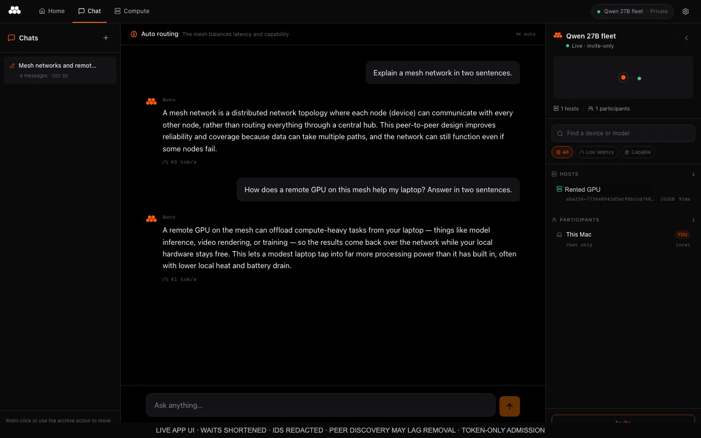

# m8s-plugin

[](docs/assets/qwen27-demo.mp4)

[Watch the one-minute demo](docs/assets/qwen27-demo.mp4) · [30-second GIF](docs/assets/qwen27-demo.gif) · [Acceptance evidence](docs/V0_ACCEPTANCE.md)

Bounded rented compute for Mesh. **The pinned stock-Mesh v0 workflow passed a
real rental, inference, app conversation and independently confirmed cleanup.**
This is an experimental, single-rental workflow; the earlier private-fork demo
is separate.

The experimental v0 sends a join token through host-key-verified SSH to stock Mesh
`--join-file`. A token supplies connection information, **not an owner-issued
worker certificate**. Use a mesh whose admission policy permits the worker and
whose operator accepts the provider's access to worker memory and inference data.
No admission policy is silently disabled. Certified admission is tracked in
[issue #1](https://github.com/Mesh-LLM/m8s-plugin/issues/1).

## Implementation

- The controller retains durable launch intent, cumulative accounting, bounded
  runtime and independent exact-resource destruction before CREATE.
- The Mesh plugin exposes `compute` operations through `m8s.operator/v0`:
  `offers`, `quote`, `launch`, `status`, and `remove`. It also retains the legacy
  read-only controller `status` tool.
- The personal [m8s-app](https://github.com/joabzzz/m8s-app) has an opt-in adapter
  to this same operation implementation. Its default certified prototype path
  is separate and still experimental.
- A worker acknowledgement, a provider's running status, or a model listing alone
  is not successful inference. Token-mode verification requires the selected
  mesh, the sole intended remote peer, the exact model response and a real canary.
- Removal requires matching provider-confirmed absence. Failed or unsettled
  attempts retain their reservations; stopped instances are not destroyed.

## Build and configuration

```sh
cargo build --locked -j2 -p m8s-cli --features prototype-vast
cargo build --manifest-path plugin/Cargo.toml --locked -j2
```

Configure `M8S_CLI` with the absolute controller executable and `M8S_V0_PLAN` with
an explicit private bounded plan. The plan selects a private `token_target` file,
immutable stock worker image, credential file, account, cumulative baseline and
cleanup reserves. Tool arguments cannot supply keys, token values, executable
paths or policy overrides. See [the v0 runbook and acceptance gates](docs/V0_TOKEN_JOIN.md).

Package/install the Mesh plugin using [plugin/README.md](plugin/README.md).
For the desktop adapter, set `M8S_PLUGIN` to the plugin executable and provide the
same controller/plan environment. For the qualified stock-main local-node path,
also set `M8S_STOCK_MESH` to the stock executable; see the app runbook. Neither
adapter creates a funding authorization.

## Evidence and scope

The plugin SDK is pinned to upstream main commit
`2809443345ea8134db62a8b433f5bb2bb5f1d123`. The real host handshake and MCP status call passed; see
[the validation checkpoint](docs/V0_VALIDATION.md). The stock worker product, selected-mesh
attachment, canary, two app chat turns and removal passed; a separate inventory
check confirmed no instances or volumes remained. See [live acceptance](docs/V0_ACCEPTANCE.md).
The published `v0.78.1` release commit is not an ancestor of this checked main tip;
its downloaded artifacts are not being relabeled as a main build.

The old certified prototype remains in source for compatibility and comparison.
See [P001](docs/decisions/P001-secure-admission.md), the
[v0 design](docs/V0_TOKEN_JOIN.md), and [repository hygiene](docs/REPOSITORY_HYGIENE.md).
Operational receipts were preserved privately and removed from the current tree.
Git history was not rewritten. [Historical evidence scope](docs/HISTORICAL_EVIDENCE.md)
explains why prior recordings cannot stand in for v0 acceptance.
